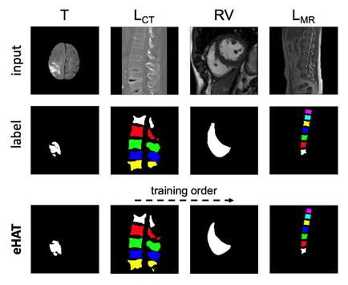

# Multi-modality Multi-organ Image Segmentation using Continual Learning with Enhanced Hard Attention to the Task (eHAT)

This repository contains the code for **eHAT (enhanced Hard Attention to the Task)**, a continual learning framework for multi-modality, multi-organ medical image segmentation. The framework is designed to sequentially learn from different medical imaging datasets (e.g., CT and MRI) and segment different organs without catastrophically forgetting previously learned knowledge.

This is the official implementation of the paper: *Multi-modality Multi-organ Image Segmentation using Continual Learning with Enhanced Hard Attention to the Task*.



## 1. How eHAT Works

eHAT builds upon the **Hard Attention to the Task (HAT)** framework. The core idea of HAT is to use task-specific "hard attention masks". For each task, the model learns a binary mask for each layer, effectively creating a sub-network by controlling which weights are used. This prevents new tasks from overwriting weights that are important for old tasks.

eHAT introduces two key modifications to make it more effective for medical image segmentation with U-Net architectures:

1.  **Adaptive Gradient Updates:** The gradient updates for the attention masks are handled differently depending on the type of connection in the U-Net. For standard convolutional layers, the update is regularized by the attention masks of both the current and parent layers. However, for layers connected via **concatenation** (the skip connections in U-Net), the regularization from the parent (decoder) layer's mask is omitted. This preserves the rich features from the encoder path, which is crucial for segmentation.

2.  **Automatic Regularization:** eHAT introduces a dynamic regularization factor that automatically adjusts the penalty on feature space usage. If a task starts to use too much of the network's capacity (i.e., its attention masks are too dense), the regularization strength increases. This encourages the model to use its capacity more efficiently and leave room for future tasks, mimicking the benefits of a dynamically expanding network without changing the architecture.

These enhancements result in a model that is more stable, forgets less, and is better suited for the complexities of multi-modal and multi-organ segmentation in a continual learning setting.

## 2. Supported Features

-   **Continual Learning for Segmentation:** Aims to solve catastrophic forgetting in medical image segmentation, where a single model can learn to segment multiple organs from different imaging modalities (CT, MRI).
-   **eHAT:** An improved version of the HAT continual learning algorithm, specifically adapted for image segmentation. It shows significantly better performance in reducing "forgetting" compared to the original HAT.
-   **HAT:** Serrà's HAT
-   **Automatic Regularization:** While using a fixed U-Net architecture, eHAT incorporates the spirit of dynamic parameter to reserve network capacity for future tasks.
-   **Multi-Organ/Multi-Modality Support:** The framework has been tested on a diverse set of medical imaging datasets:
    -   **Lumbar Spine CT (L_CT):** Vertebrae segmentation.
    -   **Right Ventricle MRI (RV):** Heart segmentation.
    -   **Brain Tumor MRI (T):** Brain tumor segmentation.
    -   **Lumbar Spine MRI (L_MR):** Vertebrae segmentation.
-   **PyTorch Implementation:** The framework is implemented in PyTorch.

## 3. Not Supported Features
-   **Preprocessing and Postprocessing:** Unavailable in this repository and would NOT be available in the future.

## 4. Project Structure

```
.
├── approach/             # Implementations of continual learning strategies (eHAT, HAT, Single-Task)
│   ├── common.py         # Base class with common training/evaluation logic for all approaches
│   ├── ehat.py           # Enhanced Hard Attention to the Task (eHAT) implementation
│   ├── hat.py            # Hard Attention to the Task (HAT) implementation
│   └── singleTask.py     # Baseline: Training each task individually
├── dataset(*)/           # Stores raw data, preprocessed data, and generated data lists
│   ├── exp_data/         # Preprocessed 2D slices for different medical imaging tasks
│   ├── lists/            # Text files containing paths to train/val/test images and masks
│   │   └── split_list/   # Per-task case splits used to regenerate the lists above
│   └── ...               # (Other dataset-related files, e.g., brats2019.py for data conversion)
├── experiments(*)/       # Saved models, training logs, and TensorBoard event files
│   └── ...               # (Folders for individual experiments like exp001, exp002, etc.)
├── zip_data(*)/          # Compressed .npz files of preprocessed data for efficient loading
├── model/                # Neural network architectures (U-Net variants)
│   ├── unet_ehat.py      # U-Net adapted for eHAT
│   ├── unet_hat.py       # U-Net adapted for HAT
│   ├── unet.py           # Standard U-Net (used for Single-Task approach)
│   ├── unet25_ehat.py    # Smaller U-Net variant for eHAT (e.g., 25% capacity)
│   └── unet50_ehat.py    # Medium U-Net variant for eHAT (e.g., 50% capacity)
├── dataList.py           # Script to generate train/val/test data lists
├── loader.py             # Handles loading and saving of preprocessed data (.npz files)
├── predict.py            # Script for evaluating trained models and saving predictions
├── README.md             # This documentation file
├── requirements.txt      # List of Python dependencies
├── run.py                # Main script for orchestrating model training
├── example.sh            # Example script to run training and prediction
├── setup_all.sh          # Script to set up the Python environment and dependencies
└── utils.py              # Utility functions (metrics, logging, file operations, model weight handling)

(*)= not supported
```

## 5. Getting Started

### 5.1 Prerequisites

-   **Operating System:** Ubuntu 20.04 (recommended) or newer version
-   **Python:** 3.8.x
-   **CUDA:** 11.8 (specified in `setup_all.sh` for PyTorch 1.13.1, adjust if using a different CUDA version or GPU setup)

To set up the Python environment and install dependencies, we recommend using `conda`:

1.  **Run the Setup Script:**
    ```bash
    ./setup_all.sh <your_env_name>
    ```
    Replace `<your_env_name>` with your desired conda environment name (e.g., `ehat_env`). This script will create a new conda environment and install all necessary packages, including `torch` and `torchvision`.

2.  **Activate the Environment:**
    ```bash
    conda activate <your_env_name>
    ```

Alternatively, you can install dependencies directly using `pip` from `requirements.txt`:

```bash
pip install -r requirements.txt
```


### 5.2 Data Preparation
```
Raw data (CT / MRI volumes)
  │  your own preprocessing
  ▼
① 2D slices (.mat)    dataset/exp_data/<task>/2DSlice/            
② Split lists         dataset/lists/split_list/*.txt              
  │  python run.py --reset ...
  ▼
③ Data lists          dataset/lists/{train,val,test}_list/*.txt   
④ Compressed data     zip_data/<task>_{train,test}.npz            
```  

1.  **Download Datasets:**  
Prepare your raw datasets (Lumbar Spine CT, Right Ventricle MRI, Brain Tumor MRI, Lumbar Spine MRI).

2.  **Preprocess and Augment Data (as needed):**  
Ensure your data is preprocessed and structured such that `images` and `masks` folders exist for each dataset within the `dataset/exp_data/` directory. (see `5.3 Data Format Specification` below)
    
3. **Create Data Lists**  
Choose one of the following methods to generate the dataset lists and compressed .npz files.  
  
    1.  **Create Data Lists by `run.py` (Recommended):**  
The `run.py` script can automatically handle the generation of training, validation,
    and test lists (`.txt` files) and subsequently convert them into optimized, compressed
    `.npz` files. Use the `--reset` flag to initiate this process, and optionally specify custom 
    data split percentages using `--split`.

        ```bash
        python run.py --reset --split 0.8 0.1 0.1 ... (other training arguments)
        ```

        * `--reset`: This flag instructs `run.py` to recreate the `.txt` data lists (using
    `dataList.py` internally) and then generate the `.npz` files via `loader.py`.
        * `--split 0.8 0.1 0.1`: Specifies the train, validation, and test split ratios 
    (e.g., 80% train, 10% validation, 10% test). This argument only takes effect when `--reset`
    is also used.

        After this step, the `dataset/lists/` directory will contain the `.txt` files, and the
        `zip_data/` directory will contain the `.npz` files, ready for efficient training. You do
        not need to run `dataList.py` or `loader.py` manually when using this method.    

  
    
    2.  **Create Data Lists by yourself (Optional, not Recommended):**  
Manually generate the split list by yourself. You need to generate a split_list first.
    Please refer to the `dataset/lists/split_list/*.txt` for the specific sturcture.
    Once the `.txt` data lists are created, the `run.py` script will automatically invoke the `loader.py`
    module to convert these lists into highly optimized, compressed `.npz` files. These `.npz` files are
    stored in the `zip_data/` directory and significantly accelerate data loading during model training.
    Typically, you do not need to run `loader.py` manually.

### 5.3 Data Format Specification

This repository does **not** ship preprocessing code (see `3. Not Supported Feature` above). If you bring
your own data, you must convert it into the format described here; this section documents what
`run.py` expects to find on disk.

1. **Image and Mask Slices (`.mat`)**

    | Item | Requirement |
    |---|---|
    | Slice size | 192 x 192 (matches the default `--size 1 192 192`) |
    | Image values | Normalized to the range **[-1, 1]** |
    | Mask values | Integer class indices starting at 0 |


2. **Directory Layout and File Naming**
    1. 2D Slices  (`dataset/exp_data/`)   
    preprocessed 2D slices for different medical imaging tasks      

        ```
        dataset/exp_data/<task>/2DSlice/
        ├── data/                                            # original slices (required)
        │   └── <subject>/
        │       ├── images/imageSlice001.mat
        │       └── masks/maskSlice001.mat
        └── augmentation/                                    # augmented slices (optional)
                └── <type>/
                    ├── <subject>/images/imageSlice001.mat
                    └── <subject>/masks/imageSlice001.mat
        ```
     2. Split Lists (`dataset/lists/split_list/*.txt`)   
      records which cases belong to train / val / test and is the input used to regenerate the three list folders
        ```
        train: ['16', '22', '24', '13', '11', '18', '21', '14', '23', '20']
        val: ['25', '19']
        test: ['15', '17', '12']
        ```
    3. Data Lists (`dataset/lists/{train,val,test}_list/<task>_{train,val,test}.txt`)  
     one sample per line, image path and mask path separated by a single space
        ```
        ./dataset/exp_data/lumbar/2DSlice/data/subject17/images/imageSlice001.mat ./dataset/exp_data/lumbar/2DSlice/data/subject17/masks/maskSlice001.mat
        ```

    4. Compressed Data (`zip_data/<task>_{train,test}.npz`)  
    `loader.py` packs the data lists into `.npz` files for faster loading 


### 5.4 Training

The `run.py` script is the main entry point for training models.

**Example: Training with the `ehat` approach on four tasks**

```bash
python run.py --approach ehat --seed 0 --fourTasks
```

**Key Arguments:**

-   `--approach`: The continual learning strategy to use (`ehat`, `hat`, `singleTask`, `Unet25`, `Unet50`).
    -   `ehat`: Uses the eHAT strategy with the default U-Net.
    -   `hat`: Uses the original HAT strategy with the default U-Net.
    -   `singleTask`: Trains a standard U-Net independently for each task.
    -   `Unet25`: Uses a smaller U-Net variant (approx. 25% capacity) with eHAT.
    -   `Unet50`: Uses a medium U-Net variant (approx. 50% capacity) with eHAT.
-   `--seed`: An integer (0-5) to determine the order of tasks for training. Different seeds result in different task sequences.
-   `--fourTasks`: Use all four datasets (Lumbar, RV, Tumor, Lumbar\_MR); otherwise, a subset of three will be used based on the seed.
-   `--epochs`: Number of training epochs per task.
-   `--batch`: Batch size.
-   `--slr`: Initial learning rate.
-   `--elr`: End (minimum) learning rate, used for learning rate decay.
-   `--size`: Input image size `[C, W, H]` (e.g., `1 192 192` for 1 channel, 192x192 images).
-   `--lazy_loading`: (Optional) Use lazy loading for datasets to reduce memory usage, especially for large datasets.

### 5.5 Prediction

The `predict.py` script is used to evaluate a trained model.

**Example: Evaluating an `ehat` model**

```bash
python predict.py --approach ehat --path /path/to/your/trained/model --seed 0 --fourTasks
```

**Key Arguments:**

-   `--approach`: The model approach used during training (must match the trained model's approach).
-   `--path`: Path to the saved model weights (`.pth` file). For `singleTask` approach, provide comma-separated paths to multiple models.
-   `--seed`: The seed used during training to ensure the correct task order is loaded.
-   `--fourTasks`: Must match the `--fourTasks` setting used during training.
-   `--save`: If specified, saves the predicted segmentation masks as `.npy` files in the `--res` directory.
-   `--res`: Directory to save the predicted results (images, predictions, labels). Defaults to `./result`.
-   `--size`: Input image size `[C, W, H]`. Must match the size used during training.
-   `--clean`: (Optional) If specified with `--save`, cleans (removes) the `--res` directory before saving new results.

## 6. Citation
### eHAT & HAT
If you use this code, please cite the following work: 
- Ming-Long Wu, Yi-Fan Peng. Multi-modality multiorgan image segmentation using continual learning with enhanced hard attention to the task. Med Phys. 2025; 52:e17842. https://doi.org/10.1002/mp.17842

Also, Serrà's HAT: 
- Serrà, J., Surís, D., Miron, M. & Karatzoglou, A.. (2018). Overcoming Catastrophic Forgetting with Hard Attention to the Task. Proceedings of the 35th International Conference on Machine Learning, in PMLR 80:4548-4557. http://proceedings.mlr.press/v80/serra18a.html
- github: https://github.com/joansj/hat

### Dataset
We do not have permission to redistribute these datasets. Please obtain them from the original sources listed below.

Please also cite the following work if you use any of them:

*   **Lumbar Spine CT dataset:**
    * MICCAI. The xVertSeg Challenge. https://lit.fe.uni-lj.si/xVertSeg/
*   **Right Ventricle MRI dataset:**
    * Petitjean C, Zuluaga MA, Bai W, et al. Right ventricle segmentation from cardiac MRI: a collation study. Medical image analysis. 2015;19(1):187-202. https://pubmed.ncbi.nlm.nih.gov/25461337/
*   **Brain Tumor MRI dataset:**
    * Bakas S, Akbari H, Sotiras A, et al. Segmentation Labels for the Pre-operative Scans of the TCGA-GBM collection. In. doi: 10.7937/K9/TCIA.2017.KLXWJJ1Q2017. https://www.cancerimagingarchive.net/analysis-result/brats-tcga-gbm/
    * Bakas S, Akbari H, Sotiras A, et al. Segmentation Labels for the Pre-operative Scans of the TCGA-LGG collection. In. doi: 10.7937/K9/TCIA.2017.GJQ7R0EF2017. https://www.cancerimagingarchive.net/analysis-result/brats-tcga-lgg/
    * Bakas S, Akbari H, Sotiras A, et al. Advancing the cancer genome atlas glioma MRI collections with expert segmentation labels and radiomic features. Scientific data. 2017;4(1):1-13. https://www.nature.com/articles/sdata2017117
    * Bakas S, Reyes M, Jakab A, et al. Identifying the best machine learning algorithms for brain tumor segmentation, progression assessment, and overall survival prediction in the BRATS challenge. arXiv preprint arXiv:181102629. 2018. https://arxiv.org/abs/1811.02629
    * Menze BH, Jakab A, Bauer S, et al. The multimodal brain tumor image segmentation benchmark (BRATS). IEEE transactions on medical imaging. 2014;34(10):1993-2024. https://ieeexplore.ieee.org/document/6975210
*   **Lumbar Spine MRI dataset:**
    * Chu C, Belavý DL, Armbrecht G, Bansmann M, Felsenberg D, Zheng G. Fully automatic localization and segmentation of 3D vertebral bodies from CT/MR images via a learning-based method. PloS one. 2015;10(11):e0143327. https://journals.plos.org/plosone/article?id=10.1371/journal.pone.0143327
 
## 7. Disclaimer

This software is intended solely for research use. It is not intended for diagnostic, therapeutic, or any other clinical use.  

The software is provided "as is", without warranty of any kind. The developers assume no responsibility for any consequences arising from the use of this software.

